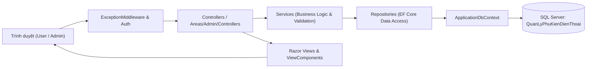
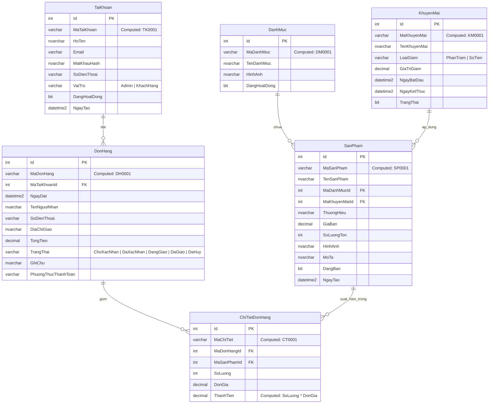
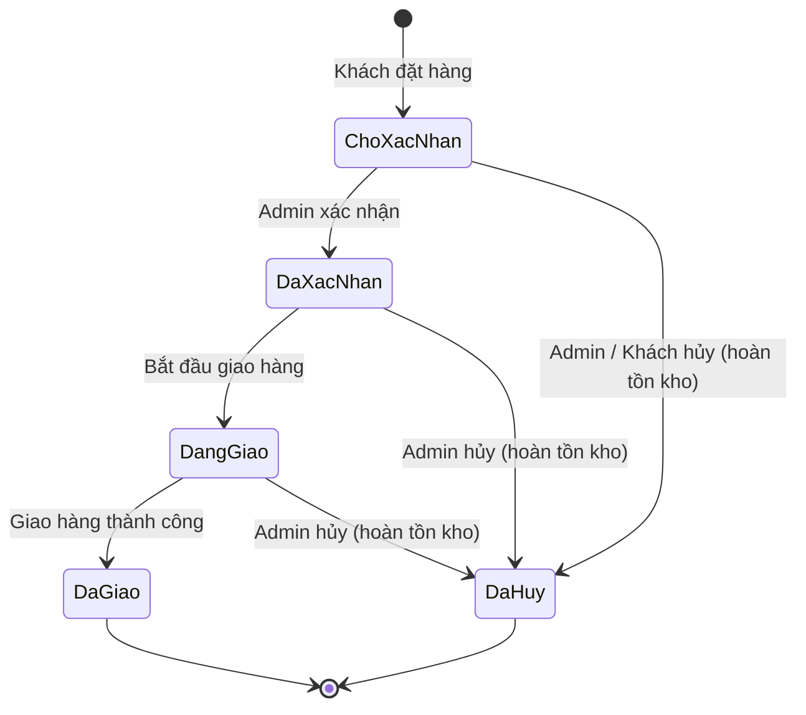

# KIẾN TRÚC HỆ THỐNG (SYSTEM ARCHITECTURE)

**Dự án:** Website Quản Lý Phụ Kiện Điện Thoại (`DoAnNhom08LTW`)  
**Người phụ trách tài liệu:** Phan Chí Thành  
**Công nghệ:** ASP.NET Core MVC (.NET 8), Entity Framework Core 8, SQL Server (`QuanLyPhuKienDienThoai`)

---

## 1. Tổng quan kiến trúc phân tầng

Hệ thống áp dụng kiến trúc **MVC + Service + Repository Pattern** nhằm tách biệt rõ ràng giữa tầng trình bày (UI), tầng xử lý nghiệp vụ (Business Logic) và tầng truy cập dữ liệu (Data Access). Cách tổ chức này giúp tăng tính bảo trì, tái sử dụng mã nguồn và hạn chế xung đột khi các thành viên phát triển song song trên các nhánh Git riêng biệt.



### Trách nhiệm từng tầng

| Tầng | Thư mục | Trách nhiệm chính |
|------|---------|-------------------|
| **Presentation (View & ViewComponent)** | `Views/`, `Areas/Admin/Views/`, `ViewComponents/` | Hiển thị giao diện HTML/Razor, nhận dữ liệu biểu mẫu, hiển thị thông báo (`TempData`) và thành phần dùng chung (`CartSummaryViewComponent`, `NotificationViewComponent`). |
| **Controller** | `Controllers/`, `Areas/Admin/Controllers/` | Tiếp nhận HTTP Request, kiểm tra xác thực/phân quyền (`[Authorize]`), validate `ModelState`, bảo vệ CSRF (`[ValidateAntiForgeryToken]`), gọi `Service` và trả về `View`/`Redirect`/`Json`. |
| **Service (Business Logic)** | `Services/Interfaces/`, `Services/Implementations/` | Xử lý quy tắc nghiệp vụ: kiểm tra trùng lặp, kiểm soát luồng chuyển trạng thái đơn hàng, hoàn trả tồn kho khi hủy đơn, xóa mềm sản phẩm, xử lý upload ảnh, tổng hợp số liệu thống kê Dashboard. |
| **Repository (Data Access)** | `Repositories/Interfaces/`, `Repositories/Implementations/` | Đóng gói truy vấn Entity Framework Core (`LINQ`, `Include`, lọc, tổng hợp), tách biệt logic nghiệp vụ khỏi `ApplicationDbContext`. |
| **Data & Models** | `data/ApplicationDbContext.cs`, `Models/`, `Models/ViewModels/` | Định nghĩa thực thể ánh xạ bảng CSDL, cấu hình cột tự sinh (`Computed Column`), khóa ngoại và các `ViewModel` phục vụ biểu mẫu/hiển thị. |
| **Middleware & Cross-cutting** | `Middleware/ExceptionMiddleware.cs`, `ILogger` | Bắt ngoại lệ toàn cục, ghi log tập trung và điều hướng trang lỗi thân thiện. |

---

## 2. Cấu trúc thư mục dự án

```text
DoAnNhom08LTW/
├── Areas/
│   └── Admin/
│       ├── Controllers/
│       │   ├── DashboardController.cs      # Thống kê tổng quan & doanh thu theo tháng
│       │   ├── CategoryController.cs       # CRUD danh mục
│       │   ├── ProductController.cs        # CRUD, xóa mềm & quản lý tồn kho sản phẩm
│       │   ├── PromotionController.cs      # CRUD chương trình khuyến mãi
│       │   └── OrderController.cs          # Xem, xác nhận, hủy & cập nhật trạng thái đơn hàng
│       └── Views/
│           ├── Shared/_Layout_admin.cshtml # Layout quản trị chung
│           ├── Dashboard/                  # Index.cshtml (Thẻ thống kê, biểu đồ doanh thu, đơn gần đây)
│           ├── Category/                   # Index.cshtml, Create.cshtml, Edit.cshtml
│           ├── Product/                    # Index.cshtml, Create.cshtml, Edit.cshtml
│           ├── Promotion/                  # Index.cshtml, Create.cshtml, Edit.cshtml
│           └── Order/                      # Index.cshtml, Details.cshtml
├── Controllers/
│   ├── AccountController.cs                # Đăng nhập, đăng ký, hồ sơ, quản lý tài khoản
│   ├── HomeController.cs                   # Trang chủ
│   ├── ProductController.cs                # Hiển thị & lọc sản phẩm phía người dùng
│   ├── CartController.cs                   # Giỏ hàng & thanh toán
│   └── OrderController.cs                  # Lịch sử đơn hàng của khách hàng
├── data/
│   └── ApplicationDbContext.cs             # Cấu hình DbSet & Computed Columns
├── Middleware/
│   └── ExceptionMiddleware.cs              # Xử lý lỗi tập trung
├── Models/
│   ├── TaiKhoan.cs
│   ├── DanhMuc.cs
│   ├── KhuyenMai.cs
│   ├── SanPham.cs
│   ├── DonHang.cs
│   ├── ChiTietDonHang.cs
│   └── ViewModels/
│       ├── Admin/                          # DashboardViewModel, Form ViewModels, Helpers
│       ├── LoginViewModel.cs
│       ├── RegisterViewModel.cs
│       ├── ProfileViewModel.cs
│       ├── CartViewModel.cs
│       └── CheckoutViewModel.cs
├── Repositories/
│   ├── Interfaces/                         # IAccountRepository, ICategoryRepository, IOrderRepository, IAdminProductRepository, IPromotionRepository, IProductRepository
│   └── Implementations/
├── Services/
│   ├── Interfaces/                         # IAccountService, ICategoryService, IOrderService, IAdminProductService, IPromotionService, IDashboardService, IProductService
│   └── Implementations/
├── ViewComponents/
│   ├── CartSummaryViewComponent.cs         # Tóm tắt số lượng & tổng tiền giỏ hàng
│   └── NotificationViewComponent.cs        # Cảnh báo đơn chờ xác nhận, tồn kho thấp, KM sắp hết hạn
└── Views/
    └── Shared/
        └── Components/
            ├── CartSummary/Default.cshtml
            └── Notification/Default.cshtml
```

---

## 3. Kiến trúc Cơ sở dữ liệu

Cơ sở dữ liệu `QuanLyPhuKienDienThoai` gồm **6 bảng chính**:



### Đặc điểm kỹ thuật CSDL
- **Computed Columns (`PERSISTED`):** Các mã hiển thị (`MaTaiKhoan`, `MaDanhMuc`, `MaKhuyenMai`, `MaSanPham`, `MaDonHang`, `MaChiTiet`) và `ChiTietDonHang.ThanhTien` được khai báo `HasComputedColumnSql(..., stored: true)` trong `ApplicationDbContext` để EF Core không chèn/ghi đè khi `INSERT`/`UPDATE`.
- **Toàn vẹn dữ liệu:**
  - Sản phẩm áp dụng **xóa mềm** (`DangBan = false`) nhằm giữ nguyên lịch sử đơn hàng (`ChiTietDonHang`).
  - Danh mục có sản phẩm liên kết sẽ bị chặn xóa cứng và khuyến nghị chuyển sang trạng thái tạm ẩn (`DangHoatDong = false`).
  - Khuyến mãi khi xóa sẽ tự động gỡ liên kết (`MaKhuyenMaiId = null`) khỏi các sản phẩm đang áp dụng trước khi xóa bản ghi.

---

## 4. Kiến trúc Module Admin & Đơn hàng

Toàn bộ controller quản trị nằm trong **Area `Admin`** với định tuyến:
```text
/{area:exists}/{controller=Dashboard}/{action=Index}/{id?}
```
và được bảo vệ bởi `[Area("Admin")]` cùng `[Authorize(Roles = "Admin")]`.

### 4.1. Luồng trạng thái đơn hàng (`OrderStatusHelper` & `OrderService`)



- Mọi thao tác chuyển trạng thái đều được kiểm tra hợp lệ qua `OrderStatusHelper.IsValidTransition`.
- Khi hủy đơn hàng (`CancelOrderAsync` hoặc cập nhật sang `DaHuy`), `OrderService` tự động hoàn trả `SoLuongTon` cho từng sản phẩm trong `ChiTietDonHangs`.

### 4.2. Thống kê Dashboard (`DashboardService` & `DashboardController`)
- **Tổng doanh thu:** Tính tổng `TongTien` của các đơn hàng có trạng thái khác `DaHuy`.
- **Tổng đơn hàng, Sản phẩm đang bán / Tổng sản phẩm, Tài khoản khách hàng:** Truy vấn trực tiếp từ SQL Server thông qua `IOrderRepository`, `IAdminProductRepository` và `IAccountRepository`.
- **Thống kê doanh thu theo tháng:** Gom nhóm đơn hàng hợp lệ theo `NgayDat.Month` (1 → 12) trong năm được chọn, hiển thị bằng biểu đồ cột (Chart.js) kết hợp bảng số liệu chi tiết và hỗ trợ endpoint JSON `/Admin/Dashboard/RevenueByMonth?year={year}`.

### 4.3. Quản lý Sản phẩm & Tồn kho (`AdminProductService` & `Areas/Admin/Controllers/ProductController`)
- Hỗ trợ lọc theo từ khóa, danh mục, trạng thái bán (`DangBan`) và mức tồn kho (`Hết hàng`, `Sắp hết <= 10`, `Còn nhiều`).
- Hỗ trợ upload hình ảnh vào `wwwroot/images/sanpham/` (kiểm tra phần mở rộng hợp lệ và giới hạn 5MB).
- Hỗ trợ cập nhật nhanh tồn kho (`UpdateStock`), xóa mềm (`SoftDelete` đặt `DangBan = false`) và khôi phục (`Restore` đặt `DangBan = true`).

### 4.4. Quản lý Danh mục & Khuyến mãi
- **Danh mục (`CategoryService`):** Kiểm tra trùng tên, upload ảnh vào `wwwroot/images/danhmuc/`, bật/tắt trạng thái hiển thị, chặn xóa khi đang có sản phẩm thuộc danh mục.
- **Khuyến mãi (`PromotionService`):** Hỗ trợ giảm theo phần trăm (`PhanTram`, giới hạn 0–100%) và giảm theo số tiền (`SoTien`, ≥ 0), kiểm tra `NgayKetThuc >= NgayBatDau`, tự động tính trạng thái hiển thị (`Đang áp dụng`, `Sắp diễn ra`, `Đã hết hạn`, `Tạm tắt`).

---

## 5. Kiến trúc ViewComponent

| ViewComponent | Vị trí View | Chức năng |
|---------------|-------------|-----------|
| `CartSummaryViewComponent` | `Views/Shared/Components/CartSummary/Default.cshtml` | Đọc dữ liệu giỏ hàng an toàn từ Session hoặc Cookie (không gây lỗi nếu Session chưa kích hoạt), tính tổng số lượng sản phẩm và tổng tiền tạm tính để hiển thị biểu tượng giỏ hàng kèm badge số lượng. |
| `NotificationViewComponent` | `Views/Shared/Components/Notification/Default.cshtml` | Truy vấn số lượng đơn hàng `ChoXacNhan`, sản phẩm đang bán có tồn kho thấp (`<= 10`) và khuyến mãi sắp hết hạn trong 7 ngày tới, hiển thị danh sách cảnh báo kèm liên kết điều hướng nhanh trên trang quản trị. |

---

## 6. Bảo mật, Pipeline & Dependency Injection

### 6.1. HTTP Request Pipeline (`Program.cs`)
1. `ExceptionMiddleware` — Bắt toàn bộ ngoại lệ chưa xử lý, ghi log bằng `ILogger`, trả JSON cho AJAX hoặc chuyển hướng `/Home/Error`.
2. `UseHttpsRedirection()` & `UseStaticFiles()` — Phục vụ tài nguyên tĩnh (`wwwroot`).
3. `UseRouting()` — Phân giải route cho `areas` và `default`.
4. `UseAuthentication()` — Xác thực bằng Cookie (`CookieAuthenticationDefaults`), hết hạn sau 2 giờ, cấu hình `LoginPath = /Account/Login`, `AccessDeniedPath = /Account/AccessDenied`.
5. `UseAuthorization()` — Kiểm soát truy cập theo `ClaimsPrincipal` và `Roles`.

### 6.2. Đăng ký Dependency Injection (Scoped)
Toàn bộ Repository và Service được đăng ký vòng đời `Scoped` (một instance trên mỗi HTTP Request, đồng bộ với vòng đời của `ApplicationDbContext`):
- `IAccountRepository` → `AccountRepository` | `IAccountService` → `AccountService`
- `ICategoryRepository` → `CategoryRepository` | `ICategoryService` → `CategoryService`
- `IOrderRepository` → `OrderRepository` | `IOrderService` → `OrderService`
- `IAdminProductRepository` → `AdminProductRepository` | `IAdminProductService` → `AdminProductService`
- `IPromotionRepository` → `PromotionRepository` | `IPromotionService` → `PromotionService`
- `IDashboardService` → `DashboardService`

### 6.3. Quy ước nhánh Git
- `main`: Nhánh ổn định sau khi review và merge.
- `feature/account-system`: Module Tài khoản & Hệ thống (Huỳnh Văn Lân).
- `feature/product-shopping`: Module Sản phẩm & Mua hàng (Nguyễn Minh Thư).
- `feature/admin-dashboard`: Module Admin & Đơn hàng (Phan Chí Thành).
